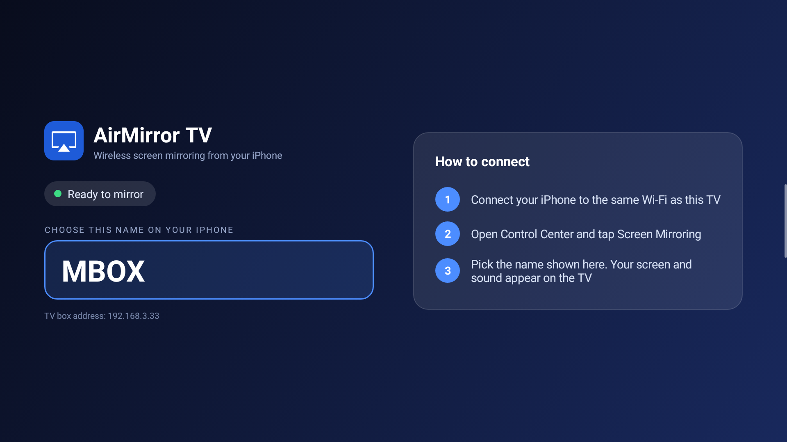

<div align="center">



# 📺 AirMirror TV

### Turn any Android TV or TV box into an AirPlay receiver

Mirror your **iPhone, iPad or Mac** to the big screen, with picture and sound.<br>
No app to install on the Apple device. No account. No Google services.

<br>

<a href="https://github.com/mbnetworku/AirPlay-Android-TV-/raw/main/AirMirrorTV.apk">
  
</a>
&nbsp;
<a href="https://github.com/mbnetworku/AirPlay-Android-TV-/releases/latest">
  
</a>

<a href="https://github.com/mbnetworku/AirPlay-Android-TV-/archive/refs/heads/main.zip">
  
</a>
&nbsp;
<a href="#-install-in-3-steps">
  
</a>
&nbsp;
<a href="https://github.com/mbnetworku/AirPlay-Android-TV-/issues/new">
  
</a>

<br><br>


[](https://github.com/mbnetworku/AirPlay-Android-TV-/actions/workflows/build-apk.yml)
[](LICENSE)

<br>

[Features](#-features) •
[Install](#-install-in-3-steps) •
[Connect](#-connect-your-iphone) •
[Remote](#-remote-control) •
[Settings](#%EF%B8%8F-settings) •
[Help](#-troubleshooting) •
[Build](#%EF%B8%8F-build-from-source) •
[Changelog](#-changelog)

</div>

---

## ✨ Features

<table>
<tr>
<td width="50%" valign="top">

### 🖥️ Screen mirroring
Your whole iPhone screen on the TV, full-screen, with hardware H.264 decoding. Letterboxed to fit, and you can rotate it with the remote.

</td>
<td width="50%" valign="top">

### 🎬 Video casting
Tap the **AirPlay** icon in Safari, YouTube and other apps to send just the video, not your whole screen.

</td>
</tr>
<tr>
<td valign="top">

### 🔊 Sound
AAC-ELD, AAC and ALAC audio. ALAC is decoded in pure Java, so music works even on boxes with a broken built-in decoder.

</td>
<td valign="top">

### 🔐 You decide who connects
A new device has to be **allowed on the TV** first. Or switch to *Anyone can connect* at home.

</td>
</tr>
<tr>
<td valign="top">

### 🧊 Liquid Glass design
Translucent glass panels over your wallpaper, built for the remote's D-pad, readable from the sofa.

</td>
<td valign="top">

### 🔄 Always ready
The receiver keeps running in the background and jumps to the front as soon as your iPhone connects.

</td>
</tr>
<tr>
<td valign="top">

### ✏️ Rename
Give the TV a friendly name like *Living Room*. That's what your iPhone shows.

</td>
<td valign="top">

### 🕰️ Works on old boxes
Android 5.0 (Lollipop) and newer. One small APK, no Google Play services needed.

</td>
</tr>
</table>

---

## 📥 Install in 3 steps

<table>
<tr>
<th>1️⃣ Download</th>
<th>2️⃣ Copy to the TV</th>
<th>3️⃣ Install</th>
</tr>
<tr>
<td valign="top">

Click **[⬇ Download APK](https://github.com/mbnetworku/AirPlay-Android-TV-/raw/main/AirMirrorTV.apk)**.

</td>
<td valign="top">

Put the APK on a **USB stick** and plug it into the TV box, or use **ADB** (below).

</td>
<td valign="top">

Open the APK with a file manager on the TV and allow **Install unknown apps** when asked.

</td>
</tr>
</table>

<details>
<summary><b>💻 Install with ADB from a computer (Windows, Mac, Linux)</b></summary>

<br>

1. On the TV: **Settings → Device Preferences → About**, press **Build** 7 times to unlock Developer options.
2. In **Developer options**, turn on **USB debugging** / **Network debugging**.
3. On the computer, connect to the TV box (use the IP address shown in the app):

```bash
adb connect <tv-box-ip>
```

4. Install (or update) the app:

```bash
adb install -r AirMirrorTV.apk
```

</details>

<details>
<summary><b>🔁 Updating</b></summary>

<br>

Install the new APK over the old one. Your receiver name and settings are kept.

</details>

> [!TIP]
> The **⬇ Download APK** button always gives the APK stored in this repository.
> The **📦 Latest Release** button gives the APK built automatically by GitHub Actions for each tagged version.

---

## 📱 Connect your iPhone

| Step | On the… | Do this |
|:---:|:---:|---|
| 1 | 📶 Both | Connect the TV box and the iPhone to the **same Wi‑Fi network** |
| 2 | 📺 TV | Open **AirMirror TV**. Note the name in the big blue box |
| 3 | 📱 iPhone | Open **Control Center → Screen Mirroring** and pick that name |
| 4 | 📺 TV | The first time, choose **Allow** on the prompt |
| 5 | 📱 iPhone | Tap **Stop Mirroring** when you're done |

**Other ways to send:**

- 🎬 **One video only:** tap the **AirPlay** icon in the video player (Safari, YouTube, …).
- 🎵 **Music only:** Control Center → audio output → pick the TV.

---

## 🎮 Remote control

| Button | Home screen | While mirroring |
|:---:|---|---|
| **OK** | Opens **Settings** (focused when the app starts) | — |
| **◀ ▶** | Move between buttons | **Rotate** the picture 90° |
| **▲ ▼** | Move between settings | — |
| **Back** | Closes Settings, or leaves the app | — |

---

## ⚙️ Settings

Settings opens right on the home screen, in the right-hand panel. Select **Done** or press **Back** to close it.

| Setting | What it does |
|---|---|
| ✏️ **Rename this receiver** | Changes the name your iPhone shows. **Default** restores the original name. |
| ✅ **Ask on the TV** *(default)* | A new device shows an **Allow / Deny** prompt on the TV first. |
| 🔢 **Require a PIN** | *Coming soon.* Works like *Ask on the TV* for now. |
| 🌐 **Anyone can connect** | No prompt. Every device on the network connects straight away. |

---

## 🐞 Troubleshooting

<details>
<summary><b>The TV isn't in the Screen Mirroring list</b></summary>

- Make sure both devices are on the **same Wi‑Fi** (not a guest network).
- Turn off **client isolation / AP isolation** on your router.
- Open the app on the TV once after installing.

</details>

<details>
<summary><b>Stuck on "Connecting…"</b></summary>

- Look at the TV: there may be an **Allow / Deny** prompt waiting.
- If there isn't one, close and reopen the app, then try again.

</details>

<details>
<summary><b>Black screen</b></summary>

Stop mirroring on the iPhone, reopen the app on the TV and mirror again.

</details>

<details>
<summary><b>YouTube says "Connected to AirPlay" but stays on an ad at 0:00</b></summary>

Known issue being investigated. For now, use **Screen Mirroring** from Control Center instead of YouTube's own AirPlay button, or stop casting and start again after the ad.
Screenshots are in [`docs/screenshots/`](docs/screenshots/).

</details>

<details>
<summary><b>No sound</b></summary>

Check the TV volume and the iPhone's silent switch, then stop and start mirroring again.

</details>

**Still stuck?** [Open an issue](https://github.com/mbnetworku/AirPlay-Android-TV-/issues/new) and attach a log from the TV box:

```bash
adb logcat -d > airmirror-log.txt
```

---

## 🛠️ Build from source

**Automatic:** every push to `main` builds the APK with GitHub Actions. Download it from the run's **Artifacts** on the [Actions page](https://github.com/mbnetworku/AirPlay-Android-TV-/actions/workflows/build-apk.yml). Pushing a tag such as `v1.17` also publishes a [Release](https://github.com/mbnetworku/AirPlay-Android-TV-/releases) with the APK attached.

**Manual:** needs **JDK 17**, **Android SDK 34** and **Gradle 8.7+**.

```bash
gradle assembleRelease -x lintVitalAnalyzeRelease -x lintVitalReportRelease -x lintVitalRelease
```

The APK is written to `app/build/outputs/apk/release/`. It's signed with the debug key, so it installs directly on a TV box.

<details>
<summary><b>🧩 How it works</b></summary>

<br>

```
iPhone ──mDNS──▶ discovery ──▶ pairing ──▶ FairPlay handshake ──▶ encrypted stream
                                                                       │
                     TextureView ◀── MediaCodec H.264 ◀── decrypt ◀────┤
                     AudioTrack  ◀── AAC (MediaCodec) / ALAC (Java) ◀──┘
```

| Path | Role |
|---|---|
| `airplay/` | AirPlay receiver protocol, based on [serezhka/java-airplay](https://github.com/serezhka/java-airplay) (MIT) and patched for Android 5 |
| `app/.../MirrorService.java` | Background service: runs the receiver, the Allow/Deny flow and the notification |
| `app/.../MainActivity.java` | Home screen, Settings panel, popups and the video surface |
| `app/.../GlassTheme.java` | Shared Liquid Glass colours, panels and buttons |
| `app/.../MirrorPlayback.java` | Routes mirroring, casting and audio to the decoders |
| `app/.../VideoDecoder.java` · `AudioDecoder.java` · `AlacDecoder.java` | Hardware video, AAC and pure-Java ALAC decoding |

</details>

---

## 📝 Changelog

| Version | What's new |
|:---:|---|
| **1.17** | 🧊 Rename popup redesigned in the glass style · ⬅️ **Back** closes Settings instead of leaving the app · ✅ Settings button shows **Done** while open · 📖 New README with download buttons · 🤖 Automatic APK builds |
| 1.16 | Liquid Glass redesign; Settings merged into the home screen |
| 1.11 | Fixed audio going silent after one dropped network packet |
| 1.10 | Fixed a video-casting leak that froze mirroring later (e.g. on YouTube ads) |
| 1.9 | ALAC audio decoded in pure Java |
| 1.3 – 1.7 | Stable receiver identity ("unable to connect" fix), Android 5/6 casting crashes |

---

<div align="center">

### 📄 License

Copyright © 2026 mbnetworku · Released under the [MIT License](LICENSE)<br>
The `airplay/` module is derived from serezhka/java-airplay (MIT); see [`airplay/LICENSE-java-airplay`](airplay/LICENSE-java-airplay).

<br>

<a href="https://github.com/mbnetworku/AirPlay-Android-TV-/raw/main/AirMirrorTV.apk">
  
</a>

⭐ If this app helps you, give the repo a star!

</div>
