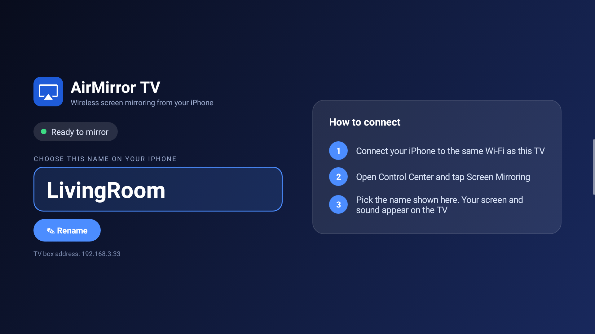

<div align="center">

# 📺 AirMirror TV

**Mirror your iPhone, iPad or Mac to any Android TV or TV box. Screen and sound, no app needed on the Apple device.**


</div>

<p align="center"></p>

---

## ✨ Features

| | |
|---|---|
| 🖥️ **Full-screen mirroring** | Hardware H.264 decoding, letterboxed to the right shape, handles rotation |
| 🔊 **Sound** | AAC-ELD, AAC and ALAC audio through the TV |
| ✏️ **Rename your receiver** | Press OK on the remote to change the name your iPhone shows |
| 📡 **Zero setup on iPhone** | Shows up as a receiver in Control Center → Screen Mirroring |
| 📦 **Small** | One 1.7 MB APK, no Google services needed |
| 🕰️ **Old boxes welcome** | Works on Android 5.0 (Lollipop) and newer |

## 🚀 Quick start

1. **Install** [`AirMirrorTV.apk`](AirMirrorTV.apk) on the TV or box (see below).
2. Put the TV box and the iPhone on the **same Wi‑Fi network**.
3. Open **AirMirror TV** on the box. It shows the receiver name.
4. On the iPhone: **Control Center → Screen Mirroring →** pick that name.
5. To stop: tap **Stop Mirroring** on the iPhone, or press Back on the remote.

### Installing the APK

```bash
adb connect <tv-box-ip>
adb install -r AirMirrorTV.apk
```

Or copy the APK to a USB stick, open it on the TV and allow *Install unknown apps*.

### Renaming the receiver

On the home screen press **OK** on the remote (or tap) on **Rename**, type a name and press Done.

<p align="center"></p>

## 🧩 How it works

```
iPhone ──mDNS──▶ discovery ──▶ pairing ──▶ FairPlay handshake ──▶ encrypted stream
                                                                       │
                       SurfaceView ◀── MediaCodec H.264 ◀── decrypt ◀──┤
                       AudioTrack  ◀── MediaCodec AAC/ALAC ◀───────────┘
```

| Module | Role |
|---|---|
| `airplay/` | AirPlay receiver protocol, based on [serezhka/java-airplay](https://github.com/serezhka/java-airplay) (MIT) and patched for Android 5 |
| `app/` | Android TV app: `MainActivity`, `VideoDecoder`, `AudioDecoder`, `MirrorPlayback` |

## 🛠️ Build

Needs JDK 17, Android SDK 34 and Gradle 8.7.

```bash
gradle assembleRelease -x lintVitalAnalyzeRelease -x lintVitalReportRelease -x lintVitalRelease
```

The APK is written to `app/build/outputs/apk/release/`.

## ⚠️ Limits

- The app must be **open on the TV** to receive.
- Casting a video with an app's own AirPlay button (YouTube and similar) is turned off. Screen Mirroring works with every app.
- Music-only AirPlay uses ALAC and needs a box with an ALAC decoder.

## 🐞 Troubleshooting

| Problem | Try |
|---|---|
| Receiver not in the list | Same Wi‑Fi? Router *client isolation* off? App open on the TV? |
| Stuck on "connecting" | Restart the app, then mirror again |
| Black screen | Stop mirroring, reopen the app, mirror again, and open an issue with `adb logcat` output |

## 📄 License

Copyright (c) 2026 mbnetworku. Released under the [MIT License](LICENSE).
The `airplay/` module is derived from serezhka/java-airplay (MIT), whose notice is kept in
[`airplay/LICENSE-java-airplay`](airplay/LICENSE-java-airplay).
